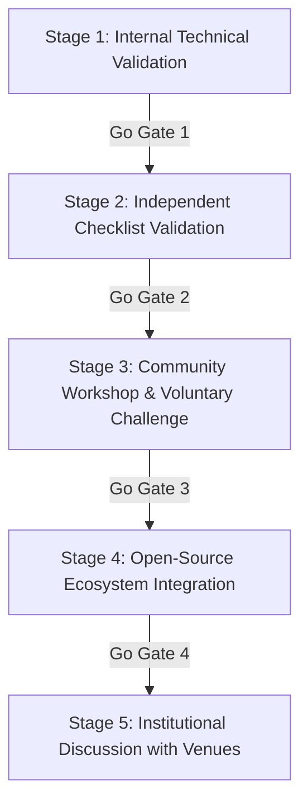

# Resource-Accounting & CME Adoption Roadmap: An Evidence-Based Progression

**Project:** Compute-Matched Evaluation (CME) Framework  
**Author:** Seyed Mahmoud Sajjadi Mohammadabadi  
**Affiliation:** University of Nevada, Reno (`mahmoud.sajjadi@unr.edu`)  
**Date:** November 2026  
**Document Status:** Operational Roadmap (Evidence-Based, No Unsubstantiated Projections)  

---

## 1. Guiding Principles

1. **Utility Over Mandates:** We measure success by whether external researchers find the software and protocol genuinely useful for designing fair experiments, not by seeking premature administrative mandates.
2. **Citations as Observed Outcomes:** Citation counts are long-term lagging indicators. They cannot be engineered or promised. We track immediate operational signals: package installations, GitHub stars, external issues, pull requests, and third-party benchmark adapters.
3. **Evidence-Based Gating:** Progress from one stage to the next requires satisfying explicit **Go / No-Go decision gates**.

---

## 2. Five-Stage Development & Engagement Progression

---

## 3. Stage-by-Stage Specifications & Decision Gates

### Stage 1: Internal Technical Validation (Q4 2026)
- **Objective:** Build a robust, bug-free, zero-dependency Python evaluation toolkit (`mae-eval`) and execute the prospective Phase 3 laboratory experiment.
- **Required Deliverables:**
  * Clean, editable pip installation (`pip install -e code/`).
  * Subprocess-verified CLI with working Markdown, LaTeX, and JSON outputs.
  * Comprehensive test suite (`pytest tests/ -v`) with 100% pass rate.
  * Phase 3 experiment results integrated into the TMLR manuscript.
- **Evidence of Success:** Subprocess tests verify CLI execution with exit code 0; `main.pdf` compiles with 0 errors.
- **Go / No-Go Gate 1:** If the installed package cannot parse raw traces or requires manual environment hacks, resolve packaging before publishing.

---

### Stage 2: Independent Checklist Validation (Q1 2027)
- **Objective:** Validate the reliability and clarity of the 6-point checklist across an empirical sample of 30 recent papers.
- **Required Deliverables:**
  * Completed dual-rater evaluation across 30 papers per `docs/CME_VALIDATION_STUDY.md`.
  * Computed inter-rater reliability statistic (Krippendorff's $\alpha$).
  * Technical report documenting completion times, question ambiguities, and revisions.
- **Evidence of Success:** Achieved Krippendorff's $\alpha \ge 0.80$ out-of-sample on the validation set.
- **Go / No-Go Gate 2:** If $\alpha < 0.67$, the checklist questions are ambiguous and must be revised before any external promotion.

---

### Stage 3: Community Workshop & Voluntary Challenge (Q2–Q3 2027)
- **Objective:** Introduce the protocol to the research community via a voluntary benchmark challenge at a top ML workshop (NeurIPS/ICLR AgentEval).
- **Required Deliverables:**
  * Workshop proposal (`docs/WORKSHOP_PROPOSAL_AGENT_EVAL.md`) submitted to workshop chairs.
  * Public release of the CME Observatory dashboard (Hugging Face Space / GitHub Pages).
  * Living repository of verified multi-agent evaluation traces.
- **Evidence of Success:** Workshop acceptance, submission of at least 15 voluntary challenge entries with verified `mae-eval` traces.
- **Go / No-Go Gate 3:** If challenge participation is low, conduct direct user interviews with authors to identify friction points in the telemetry schema.

---

### Stage 4: Open-Source Ecosystem Integration (Q4 2027 – Q1 2028)
- **Objective:** Integrate CME resource logging directly into major evaluation harnesses (`inspect_ai`, `lm-evaluation-harness`, `OpenHands`).
- **Required Deliverables:**
  * Upstream pull requests or companion plugins for standard harness libraries.
  * Comprehensive documentation and Jupyter notebook walkthroughs.
- **Evidence of Success:** Independent research papers using `mae-eval` in their experimental setup without author involvement.
- **Go / No-Go Gate 4:** Monitor PyPI download statistics and GitHub issues to ensure ongoing software maintenance.

---

### Stage 5: Institutional Discussion with Venues (2028 and Beyond)
- **Objective:** Present empirical evidence of checklist reliability and community uptake to journal editors (TMLR) and conference reproducibility chairs (NeurIPS/ICLR).
- **Required Deliverables:**
  * Empirical white paper summarizing the 30-paper validation study and workshop challenge findings.
  * Optional OpenReview form specification (`docs/CME_OPENREVIEW_FORM_SPEC.json`) provided as a community-tested resource.
- **Evidence of Success:** Venues voluntarily choose to recommend the CME checklist as an evaluation resource for reviewers in Agentic LLM tracks.

---

## 4. Operational Metrics (Replacing Citation Projections)

Rather than predicting future citations, progress will be measured against verifiable operational signals:

| Operational Metric | 6-Month Target | 12-Month Target | 24-Month Target |
| :--- | :---: | :---: | :---: |
| **PyPI Package Downloads (`mae-eval`)** | $\ge 500$ | $\ge 2{,}500$ | $\ge 10{,}000$ |
| **GitHub Repository Stars** | $\ge 100$ | $\ge 500$ | $\ge 1{,}500$ |
| **Independent External Pull Requests / Issues** | $\ge 5$ | $\ge 20$ | $\ge 50$ |
| **Papers Using `mae-eval` for Telemetry** | 1 (Self) | $\ge 5$ external | $\ge 25$ external |
| **Verified Trace Datasets in Open Observatory** | 5 studies (252 contrasts) | $\ge 12$ studies | $\ge 30$ studies |
